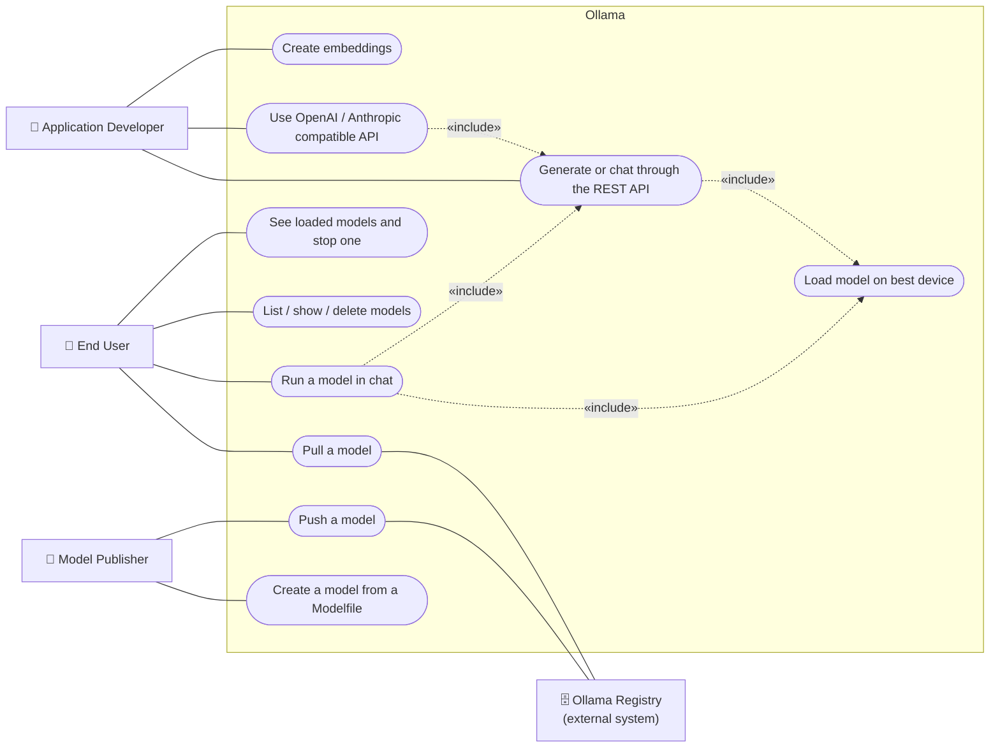
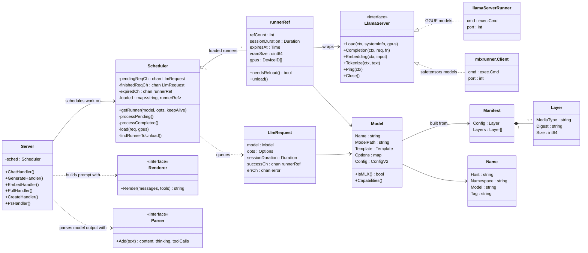
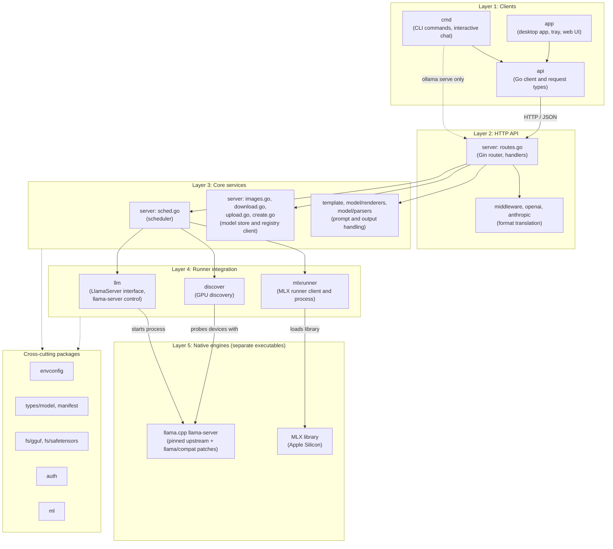
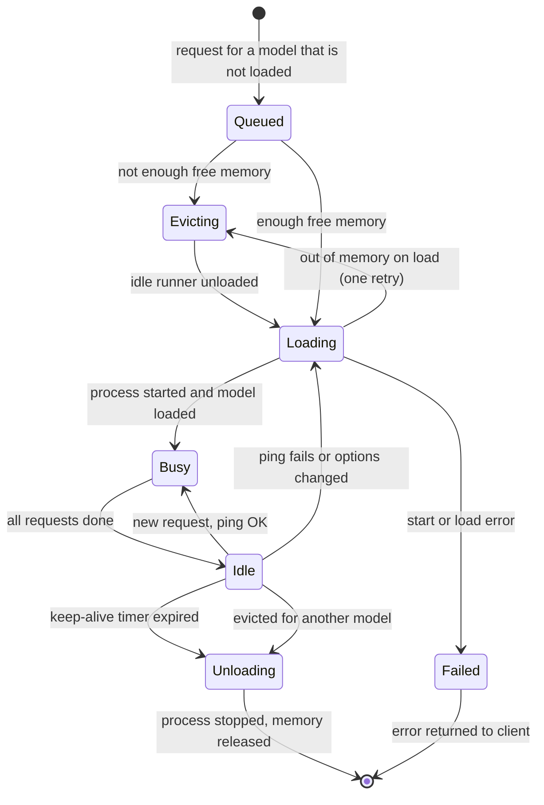
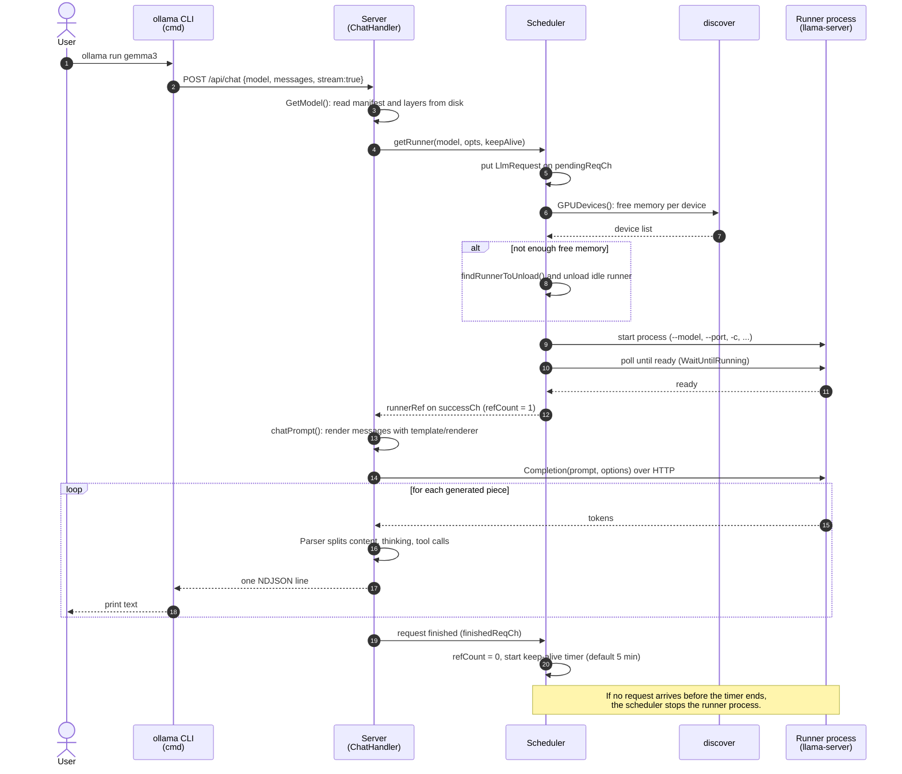
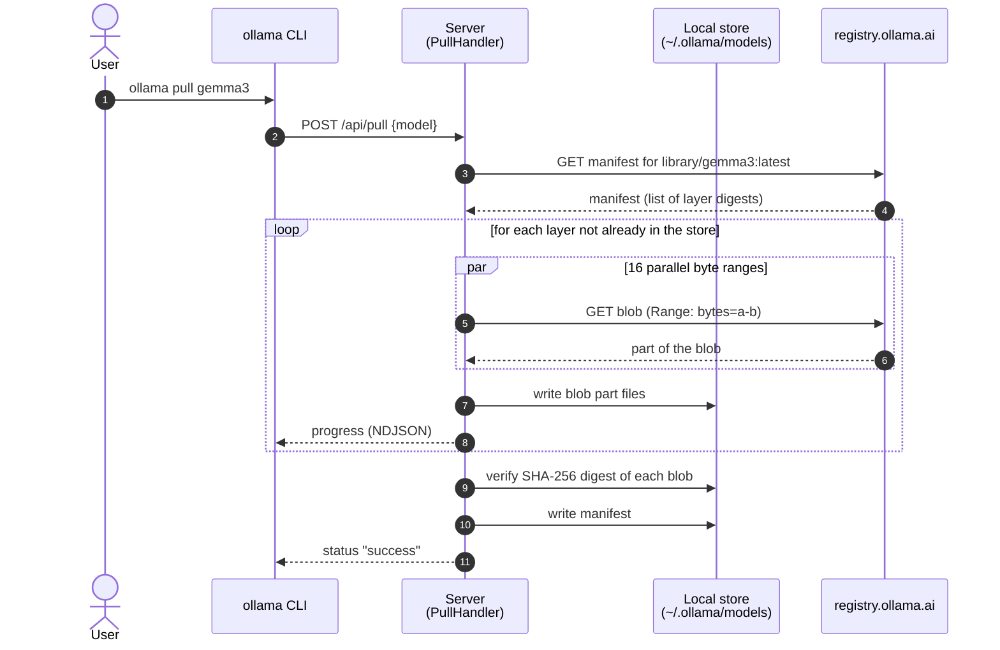
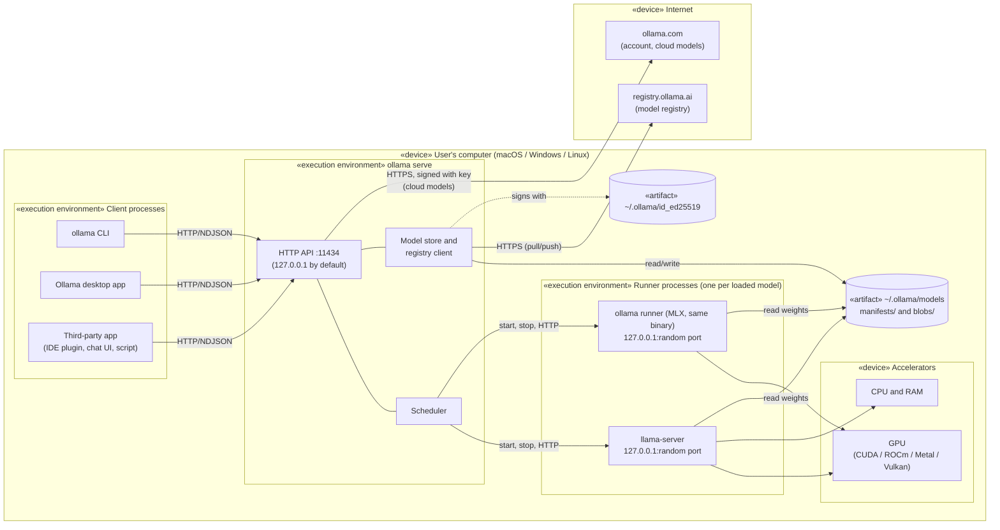

 
**Bilkent University**

**Fall 2026**  
**CS 411**  
**Software Architecture Design**

**Project \#1 Report**

Kerim Eren \- 22103759  
Mustafa Özkan İr \- 22103267  
Ali Furkan Kaya \- 22003822  
İbrahim Enes Yılmaz \- 22301744

28.10.2026

[**Selected Project	3**](#selected-project)

[**Problem Definition and Domain	3**](#problem-definition-and-domain)

[**Major Technical Problems and Proposed Solutions	3**](#major-technical-problems-and-proposed-solutions)

[**Stakeholder Expectations and Contributions	3**](#stakeholder-expectations-and-contributions)

[**Quality Requirements of the Project	4**](#quality-requirements-of-the-project)

[External Quality Requirements	4](#external-quality-requirements)

[Internal Quality Requirements	4](#internal-quality-requirements)

[Trade-offs Between the Requirements](#quality-trade-offs)

[**High-Level Architecture**](#high-level-architecture)

[Scenario View](#scenario-view)

[Logical View](#logical-view)

[Development View](#development-view)

[Process View](#process-view)

[Physical View](#physical-view)

[**Rationale Behind the Architecture**](#architecture-rationale)

[**Architectural Patterns**](#architectural-patterns)

# **Selected Project** {#selected-project}

We chose Ollama as the target OSS project. Ollama is chosen for the following reasons:

* LLMs are highly relevant in today’s software engineering world.  
* The concept of running local LLMs is more familiar to us than other projects, which will help us to better concentrate on understanding the architecture of the project. If we were to select one of the other projects, we would need to spend more time on understanding the problem definition and domain.  
* It is easier to understand and experiment with compared to other options. We can easily run it locally for testing purposes.   
* Its architectural complexity is manageable and allows for a meaningful extension.  
* Ollama exhibits a variety of architectural patterns. It also provides a basis for evaluating it from different perspectives.  
* Ollama has a diverse set of stakeholders, such as end users, model publishers, application developers, contributors, hardware vendors, and the company behind Ollama.

# **Problem Definition and Domain** {#problem-definition-and-domain}

# **Major Technical Problems and Proposed Solutions** {#major-technical-problems-and-proposed-solutions}

# **Stakeholder Expectations and Contributions** {#stakeholder-expectations-and-contributions}

| Stakeholder | Expectations | Contributions |
| :---- | :---- | :---- |
| **End users** | One-command installation; models that run smoothly on their own hardware; privacy and offline use | Bug reports, feature requests and feedback; adoption that drives the project's popularity |
| **Model publishers** | Fast and correct support for their models; reaching a wide user base | Open model weights and architectures; models and variants published to the Ollama library |
| **Application developers** | A stable, well-documented REST API; backward compatibility; OpenAI-compatible endpoints | Applications and integrations built on Ollama (chat UIs, IDE plugins, RAG tools) that grow the ecosystem; API issue reports |
| **Contributors** | Readable, modular code; clear contribution guidelines; timely pull request reviews | New features, model support, bug fixes, tests and documentation |
| **Hardware vendors** | Their hardware being well supported and performing well for local AI | Compute platforms and libraries Ollama builds on (CUDA, Metal, MLX) |
| **The company behind Ollama** | Wide adoption, a healthy community and a sustainable business (e.g., services on ollama.com) | Core development and maintenance, releases and CI, the model library and registry infrastructure, product direction |

# **Quality Requirements of the Project** {#quality-requirements-of-the-project}

We group the quality requirements into two sets. External requirements are visible to users of Ollama. Internal requirements are visible to the developers who maintain it. For each requirement, we explain why it is important for Ollama and how the current architecture supports it. We checked each claim against the Ollama source code (commit "665f9e0", October 2026). The requirements in each list are ordered by importance.

## **External Quality Requirements** {#external-quality-requirements}

1. **Usability:** This is the most important requirement, because the goal of Ollama is local inference with a single command. When a user types "ollama run gemma3", Ollama downloads the model, detects the GPUs, chooses a context size, loads the model and opens a chat. The user does not need to know how to run llama.cpp, which quantization to choose or which prompt template a model expects. The architecture supports this in two ways. First, a model is shipped as a package that holds the weights together with its prompt template, default parameters and license. The server can therefore configure the model without user input. Second, the server makes the hardware decisions itself. The scheduler picks the GPUs, the number of GPU layers and the batch size. The defaults also require no setup: the server listens on "127.0.0.1:11434" and keeps a model in memory for 5 minutes after the last request.
2. **Performance:** Language models are large. A 7B-parameter model with 4-bit quantization needs about 4 to 5 GB of memory. Users expect a short wait for the first token and a high token rate after that. Ollama does not implement the numerical work in Go. It passes the work to native inference engines: llama.cpp's "llama-server" for GGUF models and MLX for safetensors models on Apple Silicon. These engines use the GPU through CUDA, ROCm, Metal or Vulkan. The server also avoids repeated loading. A loaded model stays in memory for the keep-alive period, so a second request does not pay the load cost again. By default, up to 3 models per GPU can stay loaded, and one model can serve parallel requests when "OLLAMA_NUM_PARALLEL" is set. Model downloads are also fast, because each file is fetched in 16 parallel parts.
3. **Robustness:** Ollama should remain available under unexpected conditions. Each loaded model runs in a separate runner process. If one runner crashes, the main server process and the other runners continue to run. Before the scheduler gives a loaded runner to a new request, it pings the runner. If the runner does not answer, the scheduler loads the model again. If a load fails because the GPU is out of memory, the scheduler unloads the other models and retries the load once. The request queue is limited to 512 entries by default. When the queue is full, the server returns a "server busy" error instead of using more and more memory.
4. **Privacy and security:** Many users choose Ollama because their prompts and documents never leave their computer. The server therefore listens only on the loopback address by default. Cross-origin browser requests are accepted only from local origins unless the user changes "OLLAMA_ORIGINS". Every downloaded file is checked against its SHA-256 digest before it is used. Requests to the registry and to ollama.com are signed with a local Ed25519 key. However, the local REST API has no authentication and no authorization. Any process that can reach port 11434 can run, create or delete models. If a user sets "OLLAMA_HOST=0.0.0.0" to share the server on a network, every device on that network gets the same full access. This gap is the motivation for the IAM module that we design in a later section.
5. **Interoperability:** Many applications are written for the OpenAI or Anthropic APIs. Ollama accepts these request formats on "/v1/chat/completions", "/v1/responses", "/v1/messages" and related endpoints. A middleware layer converts these requests into Ollama's native format and converts the answers back. As a result, an existing application can switch to a local model by changing only its base URL.

## **Internal Quality Requirements** {#internal-quality-requirements}

1. **Adaptability:** The LLM field changes very quickly. New model architectures, quantization methods and hardware backends appear every few weeks, and Ollama must support them fast. Ollama does not maintain its own copy of the inference engine. It pins a version of upstream llama.cpp in the "LLAMA_CPP_VERSION" file and keeps a small set of compatibility patches in "llama/compat/". Most new model support arrives by moving this pin. Model-specific behavior that the engine does not cover is kept in small, separate files. The repository has about 20 output parsers in "model/parsers/" and about 20 prompt renderers in "model/renderers/", one file per model family. Adding a model family usually means adding a file, not changing the core server.
2. **Portability:** Ollama runs on macOS, Windows and Linux, and in Docker. It must give the same single-command experience in each environment. The server is written in Go, which compiles to a single binary for each platform. Platform-specific code is isolated in files with an OS suffix ("_darwin.go", "_windows.go", "_linux.go"); there are 42 such files. The "discover" package finds the available GPUs at runtime, so the same binary works on machines with NVIDIA, AMD, Apple or no GPU at all.
3. **Extensibility:** The scheduler talks to every inference engine through one Go interface, "LlamaServer". This interface has methods such as "Load", "Completion", "Embedding" and "Close". Two implementations exist today: one for "llama-server" and one for the MLX runner. A third engine can be added by writing a new implementation of the same interface. The scheduler and the API handlers do not need to change.
4. **Testability:** The scheduler receives its external dependencies as replaceable functions, for example the function that creates a runner and the function that lists GPUs. Tests replace these functions with fakes, so the scheduling logic can be tested without real GPUs or real models. The repository contains 393 Go test files.

## **Trade-offs Between the Requirements** {#quality-trade-offs}

The requirements above are not independent. We found three trade-offs in the current design.

**Usability over security.** The local API needs no account, no key and no login. This makes the first use very easy. The cost is that the server has no way to tell users apart. Ollama limits the risk by listening only on the loopback address by default, but the protection disappears when the user exposes the port.

**Performance over simplicity of the build.** Using native engines for each hardware family gives the best speed. The cost is a large build matrix. Ollama must build and ship "llama-server" for CPU, CUDA, ROCm, Vulkan and Metal, and it must build MLX separately.

**Adaptability over stability.** Following upstream llama.cpp closely brings new models quickly. The cost is that each update can change model loading, GPU discovery or the streaming format. The "llama/README.md" file in the repository contains a review checklist for this reason.

The table below summarizes the requirements and the main architectural decision that supports each one.

| Quality requirement | Type | Main architectural decision | Where it is in the code |
| :---- | :---- | :---- | :---- |
| Usability | External | Model package with template and parameters; automatic hardware decisions | "manifest/", "server/sched.go" |
| Performance | External | Native inference engines; keep-alive cache of loaded models; parallel downloads | "llm/", "mlxrunner/", "server/download.go" |
| Robustness | External | One OS process per loaded model; health check before reuse; bounded queue | "server/sched.go", "llm/llama_server.go" |
| Privacy and security | External | Loopback by default; origin checks; SHA-256 verification; signed registry requests | "envconfig/", "server/routes.go", "auth/" |
| Interoperability | External | Translation middleware for OpenAI and Anthropic formats | "middleware/", "openai/", "anthropic/" |
| Adaptability | Internal | Pinned upstream engine; one parser and renderer file per model family | "llama/", "model/" |
| Portability | Internal | Go single binary; OS-suffixed files; runtime GPU discovery | "discover/" |
| Extensibility | Internal | One "LlamaServer" interface for all engines | "llm/server.go" |
| Testability | Internal | Scheduler dependencies passed in as functions | "server/sched.go" |

# **High-Level Architecture** {#high-level-architecture}

To describe the architecture, we use Kruchten's 4+1 view model, which was presented in the lecture on architectural design methods. The model describes a system with four views and one set of scenarios that connects them. The logical view shows the main abstractions. The development view shows how the code is organized into modules. The process view shows the run-time processes and how they communicate. The physical view shows where the processes are deployed. The scenario view (the "+1") shows the use cases that the other views must support. The table below lists the views and the UML diagram we used for each one. It also shows the matching view in the Siemens Four Views method.

| 4+1 view | Main question | UML diagram used | Matching Siemens view |
| :---- | :---- | :---- | :---- |
| Scenario | What do the users do with the system? | Use case diagram | (input to all views) |
| Logical | What are the main abstractions? | Class diagram | Conceptual view |
| Development | How is the code organized? | Package diagram | Module view and code view |
| Process | Which processes run and how do they interact? | Sequence diagrams and a state diagram | Execution view |
| Physical | Where do the processes run? | Deployment diagram | Execution view |

Class, package and function names in the diagrams are the real names in the code, so the reader can find them. We simplified the diagrams and left out helper types.

## **Scenario View** {#scenario-view}

Figure 1 shows the main use cases. We found four actors. The *end user* uses the command-line interface (CLI) or the desktop app. The *application developer* uses the REST API from their own program. The *model publisher* creates model packages and pushes them to the registry. The *Ollama registry* is an external system that stores and serves model packages.

*Figure 1: Use case diagram (scenario view).*

Two relations are worth explaining. "Run a model in chat" includes "Generate or chat through the REST API", because the CLI does not run models itself. It sends the same REST requests that any other program sends. "Use OpenAI / Anthropic compatible API" also includes the native chat use case, because the server converts these requests into native requests. We use two of these use cases as the main scenarios in the process view: *run a model in chat* (Figure 5) and *pull a model* (Figure 6).

## **Logical View** {#logical-view}

Figure 2 shows the main abstractions of the server and their relations. We grouped them into four areas: request handling, scheduling, the runner abstraction, and the model store.

*Figure 2: Class diagram of the main abstractions (logical view).*

The **Server** receives HTTP requests. It never talks to an inference engine directly. Instead, it asks the **Scheduler** for a runner. The scheduler is the center of the design. It keeps a map of loaded runners and three Go channels: one for new requests, one for finished requests and one for runners whose keep-alive time has expired. Each **LlmRequest** waits on its own channel until the scheduler gives it a runner.

A **runnerRef** is the scheduler's record of one loaded model. It counts how many requests are using the runner ("refCount") and when the runner should be unloaded ("expiresAt"). It holds the runner itself through the **LlamaServer** interface. The interface hides which engine is used. "llamaServerRunner" starts and controls the upstream "llama-server" program for GGUF models. "mlxrunner.Client" starts and controls the MLX runner for safetensors models on Apple Silicon. "Model.IsMLX()" decides which one is used.

A **Model** is built from a **Manifest**. The manifest lists **Layers**, and each layer is a file identified by its SHA-256 digest and its media type. Typical media types are the model weights, the prompt template, the system prompt, the parameters, the license and, for vision models, the projector. A **Name** identifies a model in the form "host/namespace/model:tag". The default host is "registry.ollama.ai".

Each model family formats its prompt and its output differently. A **Renderer** turns a list of chat messages and tools into the prompt text that the model expects. A **Parser** reads the generated text and separates the normal content, the "thinking" part and any tool calls.

## **Development View** {#development-view}

Figure 3 shows how the Go code is organized into packages. We arranged the packages in layers. An arrow means "depends on". Dependencies go downward only. The native engines at the bottom are C/C++ code that Ollama builds but does not link into the Go binary. Ollama starts them as separate programs.

*Figure 3: Package diagram (development view).*

The layering is strict at the top. The CLI commands that work with models ("run", "pull", "list" and the others) use only the "api" package, which sends HTTP requests. The "cmd" package imports "server" for one reason only: the same "ollama" binary also starts the server when the user runs "ollama serve". The desktop app also talks to the server only through HTTP. For this reason the CLI and the server can run on different machines, and a third-party program has the same access as the official CLI.

The API layer has two parts. "server/routes.go" defines all endpoints with the Gin web framework. The "middleware" package, together with the "openai" and "anthropic" packages, translates foreign request formats into native ones before they reach the handler.

The core services layer has three separate areas. The scheduler manages memory and runners. The model store handles manifests and blobs on disk and talks to the registry. The prompt area holds Go templates, renderers and parsers.

The runner integration layer is the only place that knows about processes and devices. "llm" builds the command-line flags for "llama-server" and talks to it over HTTP. "mlxrunner" does the same for MLX. "discover" finds GPUs and their free memory.

The cross-cutting packages are used by many layers. "envconfig" reads all "OLLAMA_*" environment variables. "types/model" and "manifest" define model names and the manifest format. "fs" reads GGUF and safetensors files. "auth" manages the Ed25519 key.

## **Process View** {#process-view}

Ollama runs as several cooperating operating system processes. The **server process** ("ollama serve") is long-running. Inside it, Gin handles each HTTP request in its own goroutine. The scheduler runs two more goroutines: one processes pending requests and one processes finished and expired requests. **Runner processes** are started on demand, one per loaded model. Runner processes listen only on "127.0.0.1" on a free port chosen at start time. The server talks to them with HTTP. **Client processes** (the CLI, the desktop app or any other program) talk to the server with HTTP on port 11434. Responses are streamed as newline-delimited JSON (NDJSON), one JSON object per line.

Figure 4 shows the life cycle of a runner process as the scheduler sees it.

*Figure 4: State diagram of a runner (process view).*

A busy runner can accept more requests for the same model. The scheduler counts the active requests in "refCount". The runner becomes idle when this count returns to 0.

Figure 5 shows the main scenario, *run a model in chat*. The user has already pulled the model, but the model is not loaded yet.

*Figure 5: Sequence diagram for "run a model in chat" (process view).*

Three points in this scenario are important for the architecture. First, the handler goroutine is blocked only on its own channel. Other requests for models that are already loaded continue in parallel. The scheduler loads one model at a time. Second, all hardware decisions (which GPUs, how much context, which model to evict) are made in the scheduler, not in the handler. Third, the second request for the same model skips steps 6 to 11, because the runner is still loaded.

Figure 6 shows the second scenario, *pull a model*.

*Figure 6: Sequence diagram for "pull a model" (process view).*

Blobs are stored by digest, so two models that share a layer, such as the same license file, store it only once. A download that stops in the middle can continue later, because each part is saved separately.

## **Physical View** {#physical-view}

Figure 7 shows the deployment of Ollama. In the normal case, everything runs on one personal computer. Only model downloads, model uploads and optional cloud models use the network.

*Figure 7: Deployment diagram (physical view).*

The physical view shows why the security gap from the quality requirements matters. Port 11434 is the only entry point to all models, all stored data and the network operations. By default it is reachable only from the same computer. A user can make it reachable from the network with "OLLAMA_HOST", and the official Docker image does this by default. In that case, the same unprotected entry point is open to other devices. The same server can also run on a GPU server and serve many client machines. The deployment then has the same shape, but the clients are on other devices.

# **Rationale Behind the Architecture** {#architecture-rationale}

In this section we explain why Ollama has the architecture described above. We link each main decision to the quality requirements it serves and name the cost of the decision.

**Decision 1: A local client-server design instead of a single program.** Ollama could have been one program that loads a model and chats in the terminal. Instead, the CLI is only a thin HTTP client and all work happens in a background server. The main reason is interoperability. Once a model is behind an HTTP API, any program in any language can use it. The CLI, the desktop app, IDE plugins and chat UIs all share one set of loaded models. This decision also helps performance. A model loaded by one client is already warm for the next client. The cost is that the server must be running before a client can work. To keep usability high, the desktop app on macOS and Windows starts "ollama serve" itself, and the Linux install script registers the server as a systemd service.

**Decision 2: Run inference in separate processes.** The server does not load model weights into its own memory. Each model runs in its own runner process. This serves robustness first. A crash in the C/C++ engine, for example because of a GPU driver error, stops only one runner. The server can report the error and load the model again. It also serves adaptability. The server can start an unmodified upstream "llama-server" binary and talk to it over HTTP, so following new llama.cpp releases is mostly a version change. Finally, it makes memory control simple. Stopping a process releases all of its GPU memory, which the scheduler needs when it evicts a model. The cost is a small overhead for the extra HTTP hop on localhost and for process start-up.

**Decision 3: A central scheduler.** All requests for inference go through one scheduler. Only the scheduler starts and stops runners. GPU memory is the scarcest resource on a personal computer. If each handler loaded models on its own, two requests could load two large models at the same time and both would fail. The scheduler processes loads one at a time, keeps a count of users per runner and evicts idle runners first. This serves robustness and performance. The keep-alive timer is a deliberate trade-off between memory use and response time. The default of 5 minutes keeps a conversation fast but returns memory soon after the user stops.

**Decision 4: One interface for all inference engines.** The "LlamaServer" interface separates "what the server needs from an engine" from "how a specific engine works". The scheduler and the API handlers are the same for GGUF and MLX models. This serves extensibility and portability. Ollama can use the best engine for each platform without spreading platform checks through the code.

**Decision 5: Content-addressed model packages.** A model is a manifest plus blobs named by their SHA-256 digest. The format follows the idea of container images. This gives integrity, because each blob is verified after download. It also saves disk space, because shared layers are stored once, and it makes resumable downloads easy. Keeping the template and parameters inside the package serves usability, because the user gets a working configuration with the weights.

**Decision 6: Loopback binding and no built-in authentication.** Ollama targets a single user on a personal computer. For that case, binding to "127.0.0.1" gives reasonable protection and needs no setup. We think this decision fits the original goal of the project. It does not fit the growing number of shared deployments, such as a team server or a Docker container, where several people use one Ollama server. This is the main reason we chose IAM as the area for our extension.

# **Architectural Patterns** {#architectural-patterns}

We identified the following architectural patterns in Ollama. For each one, we show where it appears and which quality requirement it supports.

| Pattern | Where it is used in Ollama | Main quality requirement |
| :---- | :---- | :---- |
| Client-server | CLI, desktop app and other programs are clients of "ollama serve" | Interoperability, usability |
| Layered architecture | Clients, HTTP API, core services, runner integration, native engines (Figure 3) | Maintainability, adaptability |
| REST API | Resource-style endpoints such as "/api/tags", "/api/pull", "/api/delete" with JSON bodies | Interoperability |
| Pipes and filters | Middleware chain in Gin: CORS, host check, format translation, handler | Interoperability, extensibility |
| Adapter | Middleware that converts OpenAI and Anthropic formats; "LlamaServer" implementations that adapt each engine | Interoperability, extensibility |
| Process isolation (master-worker) | Server starts and controls one runner process per model | Robustness |
| Broker / scheduler with a queue | Scheduler matches requests to runners through channels | Performance, robustness |
| Strategy (plug-in) | Renderers and parsers chosen per model family | Adaptability |
| Content-addressed storage | Manifests and SHA-256 named blobs | Security (integrity), performance |

**Client-server.** This is the main pattern. The server owns all models and all hardware. Every client, including the official CLI, uses the same HTTP API on port 11434. We confirmed this in the code: the CLI commands create their client with "api.ClientFromEnvironment()". The "cmd" package calls into the "server" package only to start the server for "ollama serve".

**Layered architecture.** The packages form the five layers in Figure 3. Each layer uses only the layer below it and the cross-cutting packages. The layering is not perfectly strict. For example, "discover" uses "llama-server" itself to probe GPUs, so it also depends on Layer 5. We still classify the design as layered, because the top three layers do not know about processes or devices.

**REST API.** Models are resources. They are listed with "GET /api/tags", described with "POST /api/show", created with "POST /api/create" and removed with "DELETE /api/delete". The API is not fully RESTful, because some read operations use "POST" with a JSON body. Inference endpoints such as "/api/chat" are better described as remote procedure calls with streaming results.

**Pipes and filters.** Every request passes through a chain of Gin handlers before it reaches the main handler. For "/v1/chat/completions", the chain is: Gin's logger and panic recovery, CORS check, allowed-host check, inference request logging, cloud pass-through check, OpenAI-to-native translation and finally "ChatHandler". Each filter does one job and passes the request on. A new filter can be added to one route without changing the others.

**Adapter.** The pattern appears in two places. At the top, the OpenAI and Anthropic middleware adapt foreign request and response formats to Ollama's native ones. At the bottom, "llamaServerRunner" and "mlxrunner.Client" adapt two very different engines to one "LlamaServer" interface.

**Process isolation (master-worker).** The server is the master. It starts each runner as a child process, gives it a model and a port, checks its health with "Ping" and stops it when it is no longer needed. The workers do not know about each other.

**Broker with a queue.** The scheduler sits between request handlers and runners. A handler does not choose a runner. It places a request on a bounded channel and waits. The scheduler decides whether to reuse a runner, load a new one or evict an idle one. This hides resource management from the handlers.

**Strategy.** The way a prompt is built and the way output is parsed depend on the model family. The server selects a renderer and a parser for the model at run time. All renderers share one interface, and all parsers share another one. This lets the project add support for a new model family by adding one strategy.

**Content-addressed storage.** Each blob is named after the SHA-256 digest of its content. A manifest refers to blobs only by digest. The same idea is used in Docker and in Git. It gives integrity checks, removes duplicate files and supports resumable downloads.
