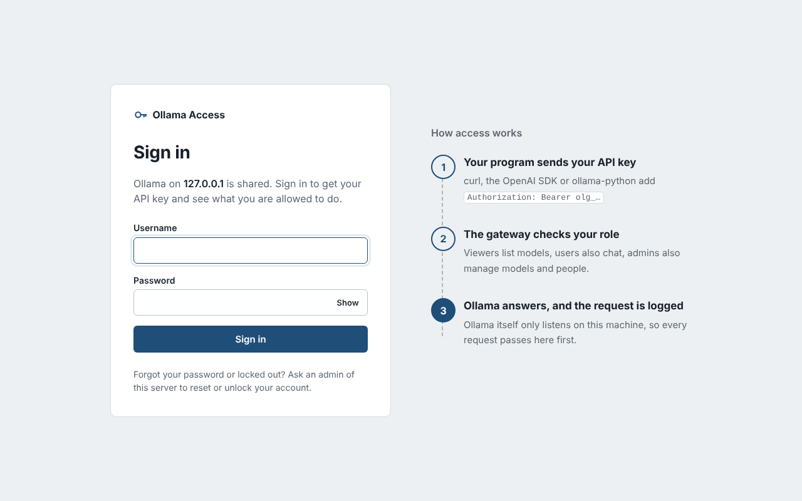
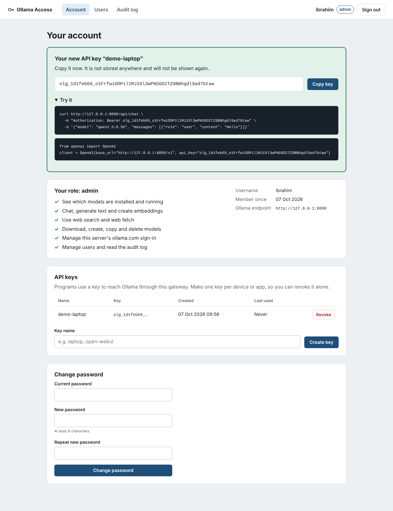
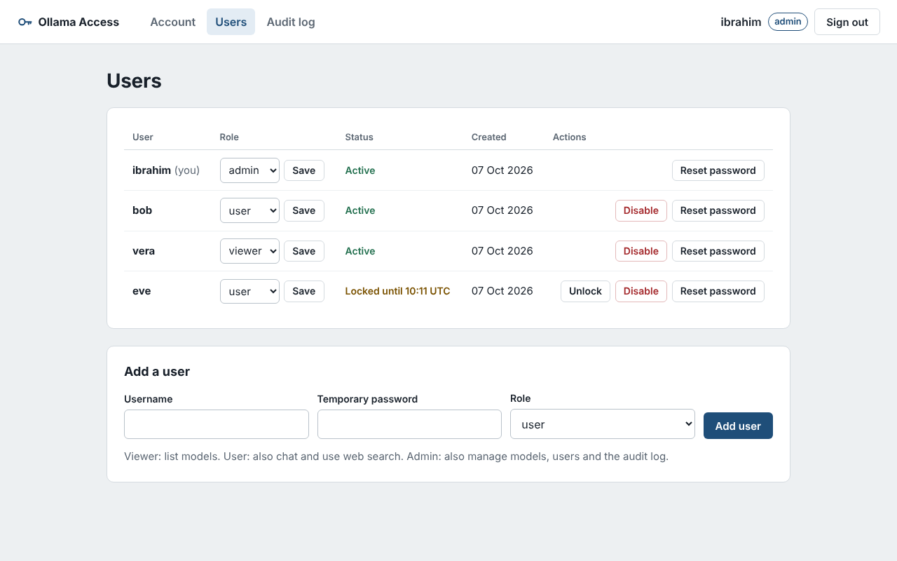
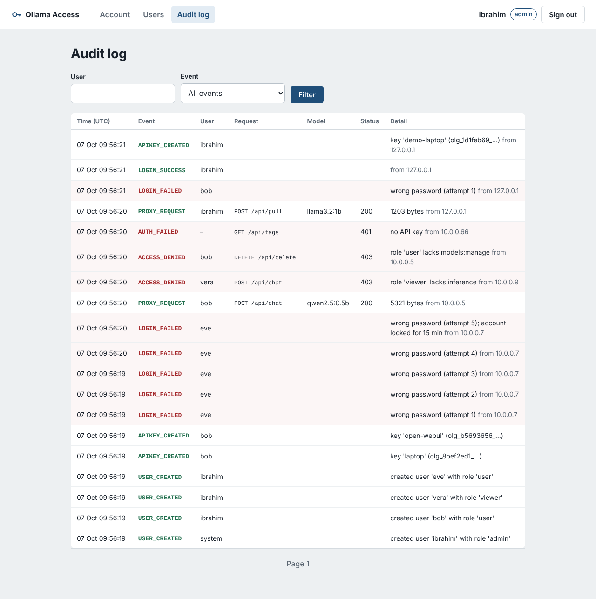

# Ollama IAM Gateway

CS411 Project #1, Task 4: a new login page and an Identity and Access Management
(IAM) module for [Ollama](https://github.com/ollama/ollama), designed from Ollama's
own requirements and written in Python.

## The problem

Ollama's HTTP API (port 11434) has **no authentication and no authorization**
(`server/routes.go` registers every route with only CORS and a host check).
Its only login, `ollama signin`, links the *machine* to an ollama.com account
for cloud models; it does not protect the local server. On a shared server
anyone who can reach the port can chat, pull models, or delete them, and
nothing is logged.

## The solution

A gateway in front of Ollama. Ollama listens on `127.0.0.1` only; every request
from outside goes through the gateway, which:

1. **authenticates** the caller (personal API key, `Authorization: Bearer olg_...`),
2. **authorizes** the request with role-based access control (viewer < user < admin, default deny),
3. **forwards** it to Ollama with streaming, and
4. **audits** it (who, what, which model, result).

People manage their access on a web console: a login page, an account page
(their role, their API keys, password change) and admin pages (users, audit log).
No Ollama code is changed.

```
browser ──/iam/*──► ┌──────────────────────────┐
                    │  Ollama IAM Gateway :8080 │──► Ollama 127.0.0.1:11434
curl / SDK ─/api/*─►│  auth → policy → proxy    │
                    └────────────┬─────────────┘
                                 └── iam.db (SQLite)
```

| Screen | |
|---|---|
| Login |  |
| Account with a new key |  |
| Users (admin) |  |
| Audit log (admin) |  |

## Requirements

- Python 3.10 or newer (developed with 3.12)
- Ollama installed and running on the same machine, bound to `127.0.0.1` (the default)
- A small model for testing, e.g. `ollama pull qwen2.5:0.5b`

## Install

```powershell
cd task4-iam-gateway
python -m venv .venv
.\.venv\Scripts\Activate.ps1          # Linux/macOS: source .venv/bin/activate
pip install -r requirements.txt
```

## Quick start

```powershell
python -m ollama_iam_gateway.cli create-admin --username admin   # asks for a password
python -m ollama_iam_gateway.cli serve
```

Open **http://127.0.0.1:8080/iam/login**, sign in, and create an API key on the
Account page. Then call Ollama through the gateway:

```powershell
curl.exe -H "Authorization: Bearer olg_..." http://127.0.0.1:8080/api/tags
```

Add more people on the **Users** page (or with `cli create-user`).

### Using it from programs

Every Ollama client works if it can send a bearer token:

```python
# OpenAI SDK: the api_key becomes "Authorization: Bearer ..."
from openai import OpenAI
client = OpenAI(base_url="http://127.0.0.1:8080/v1", api_key="olg_...")

# ollama-python
from ollama import Client
client = Client(host="http://127.0.0.1:8080", headers={"Authorization": "Bearer olg_..."})
```

## Roles and permissions

| Permission | Roles | Ollama endpoints |
|---|---|---|
| public | everyone, no key | `GET /`, `GET /api/version` |
| models:read | viewer, user, admin | `/api/tags`, `/api/show`, `/api/ps`, `/api/status`, `/v1/models` |
| inference | user, admin | `/api/chat`, `/api/generate`, `/api/embed`, `/v1/chat/completions`, `/v1/messages`, ... |
| tools:web | user, admin | `/api/experimental/web_search`, `web_fetch` |
| models:manage | admin | `/api/pull`, `/api/push`, `/api/delete`, `/api/create`, `/api/copy`, `/api/blobs/*` |
| cloud:account | admin | `/api/me`, `/api/signout` |
| iam:manage | admin | the Users and Audit log pages |
| anything else | nobody | default deny |

The full table covers all 36 routes of Ollama v0.40.0:
`python -m ollama_iam_gateway.cli show-policy`.

## Command line

All commands: `python -m ollama_iam_gateway.cli <command>`

| Command | What it does |
|---|---|
| `init-db` | Create the database tables |
| `create-admin --username NAME` | Create the first admin (password is asked twice) |
| `create-user --username NAME --role viewer\|user\|admin` | Create a user |
| `create-key --username NAME --name LABEL` | Create an API key and print it once |
| `list-users` | List users |
| `show-policy` | Print the endpoint → permission → role table |
| `check-access --role ROLE METHOD PATH` | Ask the policy engine for one decision |
| `serve [--host H] [--port P]` | Run the gateway |

## Configuration

Environment variables (all optional):

| Variable | Default | Meaning |
|---|---|---|
| `IAM_DB_URL` | `sqlite:///./iam.db` | Database |
| `IAM_OLLAMA_URL` | `http://127.0.0.1:11434` | Ollama server (must be loopback) |
| `IAM_HOST` / `IAM_PORT` | `127.0.0.1` / `8080` | Where the gateway listens. Use `0.0.0.0` to serve the network |
| `IAM_SESSION_IDLE_MINUTES` | `30` | Browser session idle timeout |
| `IAM_SESSION_MAX_HOURS` | `8` | Browser session absolute limit |
| `IAM_LOCKOUT_THRESHOLD` | `5` | Failed logins before lockout |
| `IAM_LOCKOUT_MINUTES` | `15` | Lockout duration |
| `IAM_MIN_PASSWORD_LENGTH` | `8` | Minimum password length |
| `IAM_COOKIE_SECURE` | `false` | Set `true` when served over HTTPS |

**Deployment rule:** never start Ollama with `OLLAMA_HOST=0.0.0.0`; that would let
clients bypass the gateway. To serve other machines, expose the gateway
(`IAM_HOST=0.0.0.0`), ideally behind an HTTPS reverse proxy.

## Project structure

The code follows the layered architecture in `docs/diagrams/` (component
diagram `02-component`, package diagram `07-packages`).

```
task4-iam-gateway/
├── ollama_iam_gateway/
│   ├── main.py                 app factory: wires the layers, security headers
│   ├── config.py               settings from IAM_* environment variables
│   ├── cli.py                  admin command line
│   ├── web/                    PRESENTATION LAYER (MVC controllers + views)
│   │   ├── routes_auth.py        login / logout
│   │   ├── routes_account.py     account, API keys, password
│   │   ├── routes_admin.py       users, audit log
│   │   ├── deps.py               current user, admin check, CSRF, cookies
│   │   ├── templates/            Jinja2 views
│   │   └── static/               CSS, JS, icon (no external resources)
│   ├── gateway/                GATEWAY LAYER
│   │   ├── credentials.py        Credential Resolver (Bearer key → identity)
│   │   └── proxy.py              Policy Enforcement Point + streaming proxy
│   ├── iam/                    IAM SERVICE LAYER
│   │   ├── policy.py             PolicyEngine (Policy Decision Point, RBAC table)
│   │   ├── auth_service.py       login with lockout, logout
│   │   ├── session_service.py    server-side sessions
│   │   ├── apikey_service.py     API keys
│   │   ├── user_service.py       user management
│   │   ├── audit_service.py      audit log
│   │   ├── security.py           argon2id, tokens, key format
│   │   └── errors.py
│   └── data/                   DATA LAYER
│       ├── models.py             User, UserSession, ApiKey, AuditEvent
│       ├── repositories.py       Repository pattern (the only SQL)
│       └── db.py                 engine, sessions
├── tests/                      pytest suite (206 tests)
├── scripts/
│   ├── demo_setup.py           prepares the presentation demo
│   ├── demo_step2.py           walkthrough of the IAM services (no server)
│   └── demo_step4.py           end-to-end run against your real Ollama
└── docs/
    ├── diagrams/               UML (PlantUML sources + PNG), 4+1 views
    ├── screenshots/
    └── DEMO.md                 presentation demo script and Q&A notes
```

Architectural patterns: Layered architecture, API Gateway / Reverse Proxy,
PEP/PDP separation, Role-Based Access Control, Pipes and Filters (authenticate →
authorize → forward → audit), Repository, MVC.

## Tests

```powershell
python -m pytest
```

206 tests, no Ollama needed (a fake Ollama is used). They cover the data layer,
password hashing, login and lockout, sessions, API keys, user administration,
every Ollama route in the policy (plus path-trick attacks), the proxy
(401/403/502, streaming, header stripping, auditing) and the web UI (CSRF,
cookies, one-time key display, admin pages, XSS escaping).

End-to-end check against a real Ollama (own database, port 8081):

```powershell
python scripts/demo_step4.py
```

## Security notes

- Passwords: argon2id. API keys and session tokens: only their sha256 is stored.
- Same error for unknown user and wrong password (with similar timing); lockout after 5 failures.
- Session cookie: HttpOnly, SameSite=Strict, Path=/iam. It is **not** accepted on the
  Ollama API, so other websites cannot use a signed-in browser to call Ollama (CSRF).
- CSRF tokens on every form; strict Content-Security-Policy; pages cannot be framed.
- Default deny for unknown routes; unusual paths (`..`, encoded slashes, ...) are refused.
- The gateway's `Authorization` and `Cookie` headers are removed before forwarding to Ollama.

## Known limitations (MVP)

- The `ollama` CLI cannot send an API key, so it only works on the server itself.
  Verifying its `OLLAMA_AUTH` signatures would remove this limit.
- No 2FA, per-user model allow-lists, quotas or SSO yet.
- No HTTPS in the gateway itself; use a TLS reverse proxy in production.
- Roles are fixed in code (three roles).
